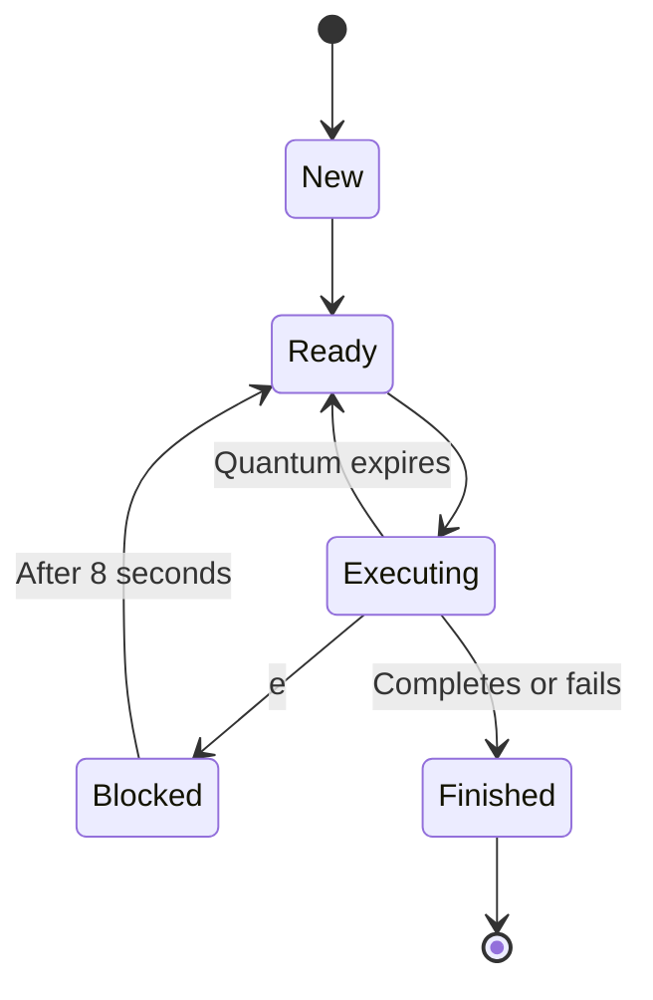

# OS Simulator

A terminal-based Operating System simulator written in [Zig](https://ziglang.org/) for my university course on Operating Systems.

OS Simulator lets you create and observe simulated processes as they move through different execution states. The application provides an interactive terminal user interface for configuring processes and monitoring execution statistics in real time.

## Features

- Interactive terminal user interface
- Process queues for:
  - New processes
  - Ready processes
  - Blocked processes
  - Finished processes
- Round-robin scheduling with a configurable quantum
- Up to five processes in memory at once
- Process state tracking
- Full-width process overview with colors for each state
- Pause, resume, block, fail, and create processes during execution
- Simulated process execution times
- Basic arithmetic operations assigned to processes.
- Process timing metrics, including:
  - Arrival time
  - Finalization time
  - Response time
  - Service time
  - Return time
  - Waiting time
  - Remaining execution time or elapsed blocked time
- Live processor and queue visualization
- Keyboard-driven controls
- Terminal resize handling
- 60 FPS rendering loop

## Requirements

- [Zig](https://ziglang.org/) `0.17.0` or newer
- A terminal emulator with support for an alternate screen and ANSI terminal controls
- A terminal size of at least 125 columns × 30 rows

## Dependencies

This project uses:

- [libvaxis](https://github.com/rockorager/libvaxis) for terminal UI rendering and input handling
- [zeit](https://github.com/rockorager/zeit) for time and duration management

## Building

Clone the repository:

```bash
git clone https://github.com/lizbh26/os_simulator.git
cd os_simulator
```

Build the application:

```bash
zig build
```

The compiled executable will be placed in the Zig installation directory:

```text
zig-out/bin/os_simulator
```

## Running

Run the application directly through the Zig build system:

```bash
zig build run
```

You can also run the compiled executable:

```bash
./zig-out/bin/os_simulator
```

## Testing

Run the test suite with:

```bash
zig build test
```

## How It Works

The program has three phases: setup, simulation, and system overview.

### 1. Setup

Enter the initial number of processes and the round-robin quantum in seconds. Both fields accept positive integers from 1 to 99. Press `Enter` to confirm each field and start the simulation.

Processes are generated automatically with unique identifiers, random arithmetic operations, and estimated execution times from 5 to 20 seconds. Operation operands range from -9999 to 9999; generated division and remainder operations avoid a zero divisor.

### 2. Simulation

The simulation displays ready and blocked processes, the executing process, and finished processes in three panels. The header shows the configured quantum, elapsed simulation time, and number of new processes awaiting admission.

The scheduler admits up to five processes into memory, counting ready, executing, and blocked processes. Additional processes remain in the new queue until a process finishes. Round-robin scheduling returns the executing process to the ready queue when its quantum expires.



A blocked process returns to the ready queue after approximately eight seconds of simulation time. Normal completion calculates the operation result; failing a process finishes it with an `ERROR` result.

### 3. Process Overview

Press `b` during execution to pause the simulation and open the process overview (the PCB or Process Control Block) table. Press `c` to resume. The overview also opens automatically when all processes have finished. Each process strip spans the terminal width and shows its identifier, state, operation, and timing metrics. 

Unavailable timing values appear as `N/A`. Finished operations show their result or `ERROR`.

## Process Operations

Generated processes use the following arithmetic operations. The operation parser also accepts the listed alternate symbols:

| Operation | Symbols |
|-----------|---------|
| Addition | `+` |
| Subtraction | `-` |
| Multiplication | `*`, `x` |
| Division | `/` |
| Remainder | `%`, `mod` |

Examples:

```text
12 + 8
25 - 7
6 * 9
100 / 4
17 % 5
```

The parser rejects division by zero and invalid expressions. The setup interface configures process count and quantum; operations are generated automatically.

## Keyboard Controls

Simulation shortcuts use lowercase letters.

| Shortcut | Action |
|----------|--------|
| `Ctrl+C` | Exit the application |
| `Ctrl+L` | Refresh the terminal display |
| `Enter` | Confirm the current setup field |
| `Backspace` | Delete input; return to the previous field when the current field is empty |
| `p` | Pause the simulation |
| `c` | Resume a paused simulation or return from the overview |
| `e` | Block the executing process |
| `w` | Finish the executing process with an error |
| `n` | Generate and enqueue a new process |
| `b` | Pause and open the process overview |
| `↑` / `↓` | Scroll finished processes in the panels, or processes in the overview while the simulation is incomplete |

Blocking, failing, adding processes, and opening the overview are available while the simulation is running. Once the simulation finishes, the final overview remains displayed until exit.

## Project Structure

```text
.
├── build.zig
├── build.zig.zon
└── src
    ├── controllers
    │   ├── application_controller.zig
    │   ├── context_controller.zig
    │   ├── render_controller.zig
    │   └── view_controller.zig
    ├── main.zig
    ├── root.zig
    ├── models
    │   ├── operation.zig
    │   ├── process.zig
    │   ├── queue.zig
    │   └── system_planner.zig
    ├── utils
    │   ├── count_utf8.zig
    │   ├── leftpad.zig
    │   ├── time.zig
    │   └── usize_to_smaller.zig
    └── view
        ├── index.zig
        ├── bootstrapper_view.zig
        ├── components
        │   ├── label.zig
        │   └── input
        └── simulation
            ├── simulation_view.zig
            ├── sim_context.zig
            ├── footer.zig
            ├── header
            ├── panels
            └── overview
```

### Core Components

- `controllers/application_controller.zig` owns application initialization, cleanup, and frame timing.
- `controllers/context_controller.zig` manages simulation phases, bootstrapping, and simulation ticks.
- `controllers/view_controller.zig` routes input and selects the setup, simulation, or overview view.
- `controllers/render_controller.zig` manages the terminal, input events, resize handling, and rendering.
- `models/process.zig` defines process state and timing metrics.
- `models/operation.zig` generates, calculates, formats, and parses arithmetic operations.
- `models/system_planner.zig` manages round-robin scheduling, memory admission, process queues, and simulation time.
- `models/queue.zig` provides a generic doubly linked queue.
- `view/bootstrapper_view.zig` configures the initial process count and quantum.
- `view/components` contains shared labels and input widgets.
- `view/simulation` contains the execution panels, header, footer, and process overview.
- `utils` contains shared helper functions.

## License

This project is licensed under the GNU General Public License v3.0. See [LICENSE](LICENSE) for details.

